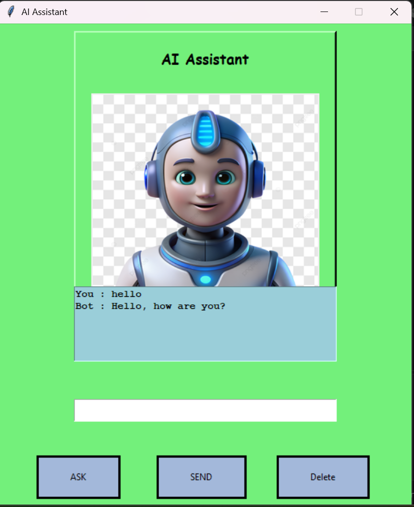

# AI Voice Assistant

A Python desktop voice assistant with a Tkinter GUI. You can talk to it with your microphone or type your command, and it replies in both speech and on-screen text. It can tell you the time, fetch live weather, open websites and play music on YouTube.

<table>
  <tr>
    <td align="center">
      <br>
      <b> Clean and simple homepage design</b>
    </td>
    <td align="center">
      <br>
      <b>Stylish registration page - Secure and responsive login page</b>
    </td>
  </tr>
</table> 

## Features

- **Voice and text input:** speak through the microphone (ASK button) or type a command (SEND button).
- **Spoken and written replies:** every answer is spoken aloud and shown in the chat box.
- **Live weather:** current temperature and condition from the [wttr.in](https://wttr.in) REST API (JSON), with error handling if the request fails.
- **Web shortcuts:** open Google and YouTube, or play music on YouTube.
- **Error handling:** handles unrecognized speech, Google Speech Recognition request failures and network errors without crashing.
- **Modular code:** the GUI, speech input, speech output, command logic and weather service live in separate files, so new commands are easy to add.

## Supported Commands

| Say or type | What the assistant does |
|---|---|
| "What is your name" / "Who are you" | Introduces itself |
| "Hello" | Greets you back |
| "Good morning" | Wishes you a good day |
| "Time" (e.g. "What is the time") | Tells the current time |
| "Weather" / "Mausam" | Tells the current weather (default city: Varanasi) |
| "Open Google" | Opens google.com in the browser |
| "Open YouTube" | Opens youtube.com in the browser |
| "Play music" | Opens a music video on YouTube |
| "Shutdown" | Says goodbye and closes the assistant |

## Tech Stack

- **Language:** Python 3
- **GUI:** Tkinter, Pillow
- **Speech to text:** SpeechRecognition (Google Speech Recognition) with PyAudio (`pyaudiowpatch` on Windows)
- **Text to speech:** pyttsx3
- **Weather:** Requests, wttr.in REST API
- **Other:** webbrowser, datetime

## Project Structure

```
AI-Voice-Assistant/
├── GUI.py              # Tkinter window, buttons and chat box
├── action.py           # Command logic: decides what to do for each input
├── speech_to_text.py   # Listens to the microphone and converts speech to text
├── text_to_speech.py   # Speaks the reply aloud
├── weather.py          # Fetches live weather from wttr.in
└── image/
    └── AI Assistant.png    # Image shown in the GUI
```

## How It Works

1. In `GUI.py`, pressing **ASK** records your voice with `speech_to_text.py`. Pressing **SEND** takes the text from the entry box.
2. The text goes to `Action()` in `action.py`, which matches it to a command (keyword matching).
3. The command runs (opens a website, gets the time, calls the weather API, and so on).
4. `text_to_speech.py` speaks the reply, and the GUI shows both your input and the reply in the chat box.

## Installation

**Requirements:** Windows, Python 3.9 or newer, a working microphone and an internet connection (speech recognition and weather both need it).

1. Clone the repository:
   ```bash
   git clone https://github.com/surajv2025/AI-Voice-Assistant.git
   cd AI-Voice-Assistant
   ```
2. Install the dependencies:
   ```bash
   pip install SpeechRecognition pyttsx3 pillow requests pyaudiowpatch
   ```
   Tkinter comes with the standard Python installer for Windows.
3. Make sure the `image/AI Assistant.png` file exists in the project folder.

## Usage

Run the app from the project folder (the image is loaded using a relative path):

```bash
python GUI.py
```

- Click **ASK** and speak your command.
- Or type a command in the box and click **SEND**.
- Click **Delete** to clear the chat box.

## Troubleshooting

- **"No default input device" or microphone not found:** check that your microphone is connected and set as the default recording device in Windows.
- **Image not found error:** run `python GUI.py` from inside the project folder so that `image/AI Assistant.png` can be found.
- **"Sorry, I did not understand that":** speak clearly and closer to the microphone, or type the command instead.
- **Weather not loading:** check your internet connection; the app shows an error message instead of crashing when the request fails.

## Limitations

- Commands are matched by keywords, so the assistant understands only the phrases listed above.
- Speech recognition uses Google's online service, so it needs an internet connection.
- `pyaudiowpatch` is used for microphone access, so the project is tested on Windows only.

## Future Improvements

- Add an LLM API as a fallback to answer open-ended questions.
- Use multithreading so the GUI stays responsive while listening.
- Add notes and reminders stored in a database.
- Add Wikipedia search and the ability to open desktop apps.
- Package the app as a standalone `.exe` with PyInstaller.

## Author

**Suraj Vishwakarma**
[GitHub](https://github.com/surajv2025) | [LinkedIn](https://linkedin.com/in/surajvishwakarma-363137289) | svishwakarmaji792@gmail.com
